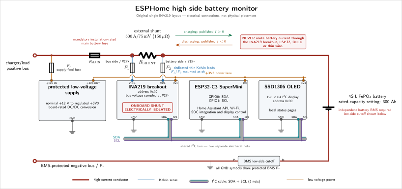

# Optional INA219 for the low-consumption branch

The original monitor uses one INA219 and a 500 A / 75 mV external shunt. The
optional second INA219 measures a separate, limited battery-side branch with
its original onboard resistor. This improves measurement of monitor consumption
and other small loads that are difficult to resolve with the large main shunt.
It does not improve the main shunt's accuracy or provide branch protection.

The same firmware supports both layouts. It probes the optional address once at
boot. If absent, it uses the original main-only measurement. If detected, it
subtracts auxiliary consumption from normalized main current. A detected board
that later stops providing fresh data makes combined measurements unavailable
until recovery. Restart re-detects the boards; addition/removal requires isolated
power and a restart. Missing-at-boot fallback cannot distinguish an intentional
single-board build from a failed or misaddressed auxiliary board. Check the
selected mode against the actual wiring during commissioning.

## Connect the auxiliary branch

Use this alternative to the original bus-side monitor supply:

```text
                           MAIN POWER BRANCH (unchanged)
battery B+ ──┬── external 500 A / 75 mV shunt ── F_MAIN ── DC+ bus
             │       main INA219 0x40: fused Kelvin leads only
             │
             └── F3 ── VIN+ [aux INA219, onboard 0.1 ohm] VIN- ── V_AUX+
                     battery-side fused branch                       ├── DC/DC battery input
                                                                     └── external AUX+ terminal

DC/DC regulated 3.3 V output ── ESP32 + OLED + main INA219 VCC + aux INA219 VCC
BMS P- / protected DC- ──────── DC/DC return + all module GND + external AUX-
battery B- ─────────────────── BMS B- only (no auxiliary return here)
```

1. Leave the main high-current path, `F_MAIN`, and both dedicated Kelvin sense
   leads unchanged. The main INA219 stays at `0x40` with its onboard resistor
   electrically isolated.
2. Take a **separate power connection** from battery positive on the battery
   side of the main shunt. Fit independent branch fuse `F3` close to that tap;
   never draw supply current through `K_BAT`, `K_BUS`, `F1`, or `F2`.
3. Feed auxiliary `VIN+` through `F3`. Retain the auxiliary board's onboard
   resistor and verify it is `0.1 ohm` (often marked `R100`) for the default
   resistance setting. A different marking/revision requires verified data and
   matching configuration.
4. Connect auxiliary `VIN-` to a distinct `V_AUX+` node. That node feeds both
   the DC/DC **battery-voltage input** and the external low-consumption `AUX+`
   terminal. `V_AUX+` is nominal battery voltage, roughly 12 V and up to 14.6 V
   for a typical 4S charge setting, less branch voltage drop; it is not 3.3 V.
   Verify the actual battery/charger limits and transients.
5. Power the ESP32, OLED, main INA219 VCC, and auxiliary INA219 VCC from the
   DC/DC's regulated **3.3 V output**. The INA219's 26 V bus measurement limit
   applies to its VIN inputs; it does not permit 12 V on VCC. Verify every
   breakout and display rating.
6. Connect DC/DC return, all module grounds, and the external `AUX-` terminal
   only to the BMS-protected `P-` / DC- return. Do not bypass BMS cutoff through
   raw battery `B-`, a USB ground, another supply, or an external consumer.
7. Remove the original bus-side DC/DC feed in this layout. Otherwise auxiliary
   consumption may bypass the new sensor or be counted twice.

The low branch is parallel to the **complete main power branch**. Never connect
its small onboard resistor end-to-end across the external shunt's terminals:
that would be an unintended high-current bypass. Do not put the 500 A main load
through the auxiliary breakout.

The detailed and installation schematics show the original layout above and
this alternative in separate lower panels:

[](../hardware/battery-monitor-schematic.svg)

## Shared I2C and address selection

On the ESP32-C3, both sensors share SDA on GPIO0 and SCL on GPIO1 with the OLED.
The ESP8266 D1 mini uses GPIO4 for SDA and GPIO5 for SCL; the detection and branch
accounting are the same. All pull-ups must
be compatible with 3.3 V, and their combined resistance must suit the bus. The
addresses are distinct:

| Device | Default address | Hardware configuration |
| --- | --- | --- |
| Main INA219 | `0x40` | A0/A1 at default low setting; onboard shunt isolated |
| Auxiliary INA219 | `0x41` | A0 high / VCC, A1 low; onboard shunt retained |
| SSD1306 OLED | `0x3C` | Display-specific default |

On the Adafruit-style breakout, bridge the **A0 address jumper** and leave A1
open/default to select `0x41`. Clones can use different pad layouts or fitted
zero-ohm links. Consult that board's schematic: move/remove a default low link
before selecting high when required. Never blindly short an address pad to VCC
while a low link still connects it directly to ground. Change jumpers only with
power removed, check for shorts, and confirm both sensor addresses in the scan.
The [Adafruit addressing guide](https://learn.adafruit.com/adafruit-ina219-current-sensor-breakout/assembly#addressing-the-boards-1633527)
documents its board's jumper convention; the
[TI INA219 datasheet](https://www.ti.com/lit/ds/symlink/ina219.pdf) defines the
IC's address table, supply limits, and measurement ranges.

The firmware defaults are auxiliary address `0x41`, shunt resistance `0.1 ohm`,
and current range `3.2 A`, configurable in
[`battery-config.yaml`](../packages/battery-config.yaml). The range is a sensor
setting, not a safe continuous board rating. Verify resistor wattage, thermal
rise, PCB traces, terminal ratings, external leads, DC/DC inrush, and external
consumer startup. Choose `F3` and any smaller downstream fuses from the lowest
hardware limit and actual fuse clearing behavior; see
[`fuse-selection.md`](fuse-selection.md).

## Verify the result

In Home Assistant, check `Auxiliary INA219 Present` and `Auxiliary Measurement
Healthy`. Both should be on for the dual layout. Presence is latched at boot;
health turns off on a measurement fault. An intentional single-sensor build has
both off and an unavailable `Auxiliary Current`, while main measurements continue.

Auxiliary `VIN+` to `VIN-` consumption is positive on its raw channel. Published
battery current and signed power retain the project's positive-charge convention:

```text
I_battery = I_main_normalized - I_aux_consumption
I_main = 0 A, I_aux = +0.060 A -> I_battery = -0.060 A
P_battery = V_battery * I_battery
```

The same net current drives charge integration, SOC, current modes, display, and
rule evaluation. A classification deadband does not remove small current from
integration. Converter input current includes its losses; measuring only its
3.3 V output would miss them. The auxiliary INA219's own logic supply is also
downstream of the measured converter input.

Complete the auxiliary sections of [`commissioning.md`](commissioning.md) with
reference measurements, fault/recovery checks, and a recorded thermal/current
limit before relying on the arrangement. No complete physical acceptance record
has been published for this prototype.
